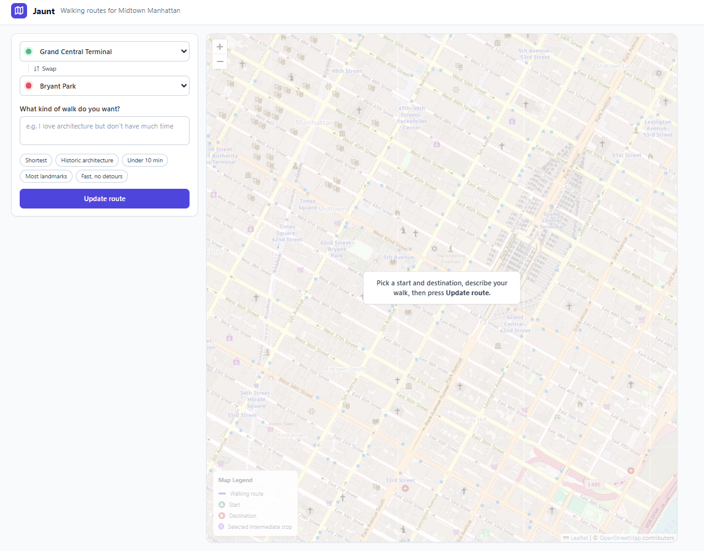
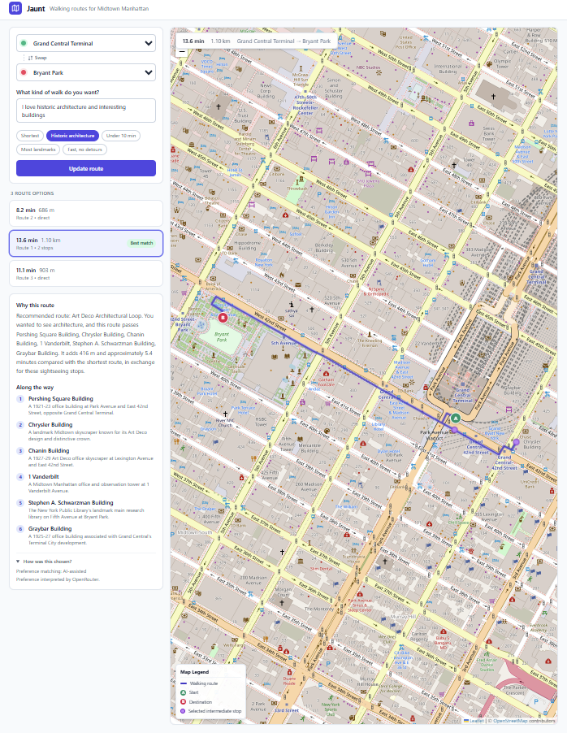

# Part 5 — Prototype Demonstration

This visual walkthrough accompanies the Jaunt technical-task submission. It uses two screenshots to show the application before and after a traveler requests a route recommendation.

## 1. Application interface

The starting screen lets the traveler choose an origin and destination, enter a natural-language walking preference, or select a suggested preference. The map provides the geographic context for the journey.

## 2. Preference-based route recommendation

In this example, the traveler selects Grand Central Terminal as the origin and Bryant Park as the destination, then requests a walk focused on historic architecture and interesting buildings.

The application presents multiple pedestrian route options, estimated walking times and distances, intermediate places, a recommended option, and an explanation of the selection. The chosen route is displayed on the map.

## How this demonstrates the task

The two screenshots show the main interaction expected by the Jaunt task: a traveler supplies a journey and describes the experience they want, and the application compares available pedestrian routes and explains its recommendation. Changing the traveler's priorities changes the criteria used to rank the available routes.

## Project and setup

The source code and setup instructions are available in the [Jaunt Route Recommender repository](https://github.com/Varun1323/jaunt-route-recommender/tree/final-working). See the root [README](../README.md) for installation and run instructions. The other documents in the `docs/` directory describe the research, geographic data sources, architecture, route methodology, recommendation logic, technical decisions, and verification results.
